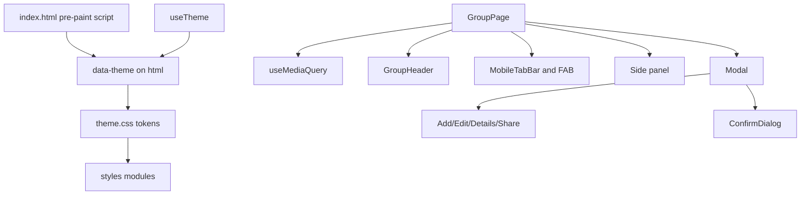

# Requirements

### Overview & Goals
Refresh the TeilFair web app (`packages/web`) so it feels modern and professional, uses the screen well from 360px phones to 1440px+ desktops, has polished light and dark modes, and is easy to use in mobile browsers. Keep the current identity (teal primary, gold accent, logo) and refine it rather than replace it.

### Scope
**In scope**
- Design tokens: spacing, type scale, surfaces and dark-mode contrast.
- Theme behavior: follow the OS setting by default, no flash of the wrong theme, browser bar color matches the app theme.
- App shell: header, footer, safe-area insets.
- Group page: CSS-driven responsive layout; phones get a bottom tab bar and a floating "Add expense" button; desktop gets a sticky summary side panel.
- One shared accessible modal, shown as a bottom sheet on phones and centered on desktop.
- Restyle expense cards and list, balances and settlements, members, empty/loading/error states, and the home page (hero, create/join, recent groups, how it works).
- Expense forms: real checkboxes, number keypad on phones, translated errors.
- Split `index.css` into ordered modules.
- Automated visual and responsive checks.

**Out of scope**
- The mobile app (`packages/mobile`) and shared calculations, store and API.
- New product features, Supabase schema and routing changes.
- Adopting Tailwind or a component library.

### User Stories
- As a phone user, I want the main actions within thumb reach so I can add an expense with one hand.
- As a desktop user, I want expenses and balances visible side by side so I don't have to switch tabs.
- As a dark-mode user, I want the app to follow my system setting without a white flash.
- As a keyboard or screen-reader user, I want dialogs and member pickers I can operate and that are announced properly.
- As any user, I want clear, friendly empty and loading states so I always know what to do next.

### Functional Requirements
- **Breakpoints:** one consistent set, mobile < 640, tablet 640–1023, desktop ≥ 1024, wide ≥ 1440.
- **Group page on phones (< 1024):**
  - Fixed bottom tab bar (Expenses / Balances / Members) with icon and label, at least 48px touch targets, and padding for the home indicator.
  - Floating "Add expense" button above the tab bar when the user has write access.
  - The group header shows name, total and access badge.
- **Group page on desktop (≥ 1024):**
  - Main column with Expenses / Members tabs, plus a sticky side panel with summary stats and balances, or expense details when one is selected.
  - Wide screens use the extra width; no tiny centered column.
- **Modals:**
  - Rendered in a portal with `role="dialog"`, `aria-modal` and a labelled title.
  - Close on Escape and on backdrop click, focus moves into the dialog and returns afterwards, page scroll is locked while open.
  - Bottom sheet with a drag-handle look on phones, centered card on desktop.
  - Content scrolls inside while header and footer stay visible.
- **Theme:**
  - The first visit follows `prefers-color-scheme` and keeps following OS changes until the user picks a theme.
  - The toggle keeps its accessible name `Theme: light|dark` and the `teilfair-theme-preference` storage key.
  - An inline script in `index.html` sets `data-theme` before first paint.
  - The `theme-color` meta tag updates to match the active theme.
- **Forms:**
  - Amount fields use `inputMode="decimal"`.
  - The split member picker uses real `<input type="checkbox">` labels.
  - Per-member amount rows are fluid instead of a fixed 120px width.
  - Errors use i18n keys (EN and DE) and have `role="alert"`.
  - Inputs are at least 16px on phones to avoid the iOS zoom.
- **States:**
  - Skeleton loading for the group page.
  - Illustrated empty states with a call to action (no members, no expenses, all settled).
  - Error cards consistent with the rest of the app.
- **Compatibility:** all existing `data-testid` values and the accessible names and headings used by the smoke tests stay working.

### Non-Functional Requirements
- WCAG AA contrast for text in both themes, visible `:focus-visible` rings, and `prefers-reduced-motion` respected.
- No horizontal scrolling at 360px.
- Tap targets at least 44px.
- No new runtime dependencies, and the CSS bundle stays about the same size or smaller.

### Review Findings Follow-up (P1, P2, P2)
The staged-change review (see the end of this document) left three open findings. They must be fixed before the refresh counts as done.

- **P1, keep stored amounts on edit:**
  - Opening Edit shows each stored amount exactly as saved. It is no longer rounded to the currency's display digits, so a legacy JPY `96.6` shows as `96.6`, not `97`.
  - Any amount field the user does not change is saved with its original stored number. This covers the total, every payer amount and every fixed split share.
  - Changed fields are still checked by the strict currency parser. For example, typing `100.5` in a JPY group still shows the whole-number error.
  - The live remaining-amount meter and the sum checks use the same values, so an untouched legacy expense shows as balanced and saves without errors.
- **P2, scroll position when switching tabs:**
  - Each section opens at a sensible position.
  - The first time a section is opened, if the page was scrolled past the panel, the panel's heading lands just below the sticky header. Otherwise the scroll stays where it is.
  - Coming back to a section restores where the user left it.
  - The jump is instant, with no smooth-scroll animation, so it also respects reduced motion.
  - Applies to the bottom tab bar, the desktop tabs, keyboard arrow selection and the "Go to members" empty-state button.
- **P2, keyboard path from the bottom tabs into their panel:**
  - On phones, pressing Tab on the selected bottom tab moves into that tab's panel, not to the footer or the page body.
  - Shift+Tab from the panel returns to the selected tab.
  - The panel can always receive focus, even when it has no controls (Balances, empty states), and shows a visible focus ring.
  - The tab bar looks and sits exactly as before, fixed to the bottom.

### Mobile Polish Follow-up (footer links, contextual FAB)
Two issues left after review on phones: the footer band looks like a second footer stacked on the bottom tab bar, and the floating "Add expense" button makes no sense on Balances. Decisions agreed with the user: a header **More** menu, applied to **all phone pages**, and a **tab-aware FAB**.

- **Legal links in a header "More" menu:**
  - Where the menu appears:
    - Every page below 640px.
    - The group page below 1024px, wherever the bottom tab bar is shown.
    - In those places `AppFooter` is not rendered visually (`display: none`), so no band sits above the tab bar.
  - Header button:
    - A ⋯ icon button in the header, after the language and theme buttons.
    - Accessible name "More" / "Mehr", with `aria-expanded` and `aria-controls`.
    - At least 44px, the same look as the other header icon buttons.
  - Menu contents:
    - A small popover anchored to the right edge under the header, with links "Privacy" and "Imprint".
    - Each link is at least 44px tall; the current page gets `aria-current="page"`.
    - Below the links, a muted caption "TeilFair · Split expenses fairly", so the brand line isn't lost.
  - Closing:
    - Escape closes the menu and returns focus to the button.
    - Clicking or tapping outside, choosing a link, or a route change closes it.
    - Tab moves through the links in order.
  - Elsewhere: tablet and desktop pages other than the group page below 1024px keep the current footer and show no ⋯ button. The desktop group page is unchanged.
  - Constraints: no horizontal overflow at 360px with back button, logo, language, theme and More all in the header. The theme toggle and "Select language" names stay unchanged.
- **Tab-aware FAB on the phone group page (< 1024, write access):**
  - Expenses tab: the FAB shows "Add expense" (`add-expense-button`), as today. It is disabled when there are no members.
  - Balances tab: no FAB. Bottom padding shrinks to the tab bar only, so no empty gap is left.
  - Members tab:
    - The FAB shows "Add member" with a person-plus icon (`add-member-button`).
    - It opens an **Add member** bottom sheet (shared `Modal`) with a labelled name input (auto-focused), an "Add" submit button and a "Done" button.
    - After each add, the field clears and stays focused so several members can be added in a row, and a polite live status says "Anna added".
    - The inline add form is not shown on phones.
  - Read-only links: no FAB on any tab.
  - Desktop (≥ 1024): unchanged. The inline member form stays on the Members tab and the "Add expense" button stays in the toolbar, so the system tests keep working.
  - The empty members state on phones points to the FAB ("Tap + to add your first member"); the desktop wording is unchanged.

# Technical Design

### Current Implementation
- **Styling:**
  - `src/theme/theme.css` holds the tokens (light and `[data-theme='dark']`) and loads DM Sans and Source Sans 3 from Google Fonts.
  - `src/index.css` is a single 2,731-line file with media queries scattered across it at 480/640/768/1023/1024/1279.
- **Theme:**
  - `theme/useTheme.ts` saves the resolved mode to localStorage on first render, so the OS setting is ignored afterwards.
  - `theme/index.ts` `injectTheme()` writes the shared package's colors, spacing and px font sizes into a `:root` style tag. That overrides `theme.css`, so there are two sources of truth.
  - No theme is set before first paint, which causes a light flash.
- **Layout:**
  - `pages/GroupPage.tsx` switches between tabs and side panel in JavaScript with `useScreenSize` (resize listener).
  - It contains many inline styles, as do `BalancesSummary.tsx` and `AddExpenseForm.tsx`.
- **Modals:**
  - `AddExpenseModal`, `EditExpenseModal`, `ExpenseDetailsModal` and `ShareModal` are bare overlay divs with no dialog role, Escape handling or focus management.
  - `ConfirmDialog.tsx` is already done well (portal, Escape, focus, `alertdialog`) and serves as the reference.
- **i18n:** strings live in `packages/shared/src/i18n/locales/{en,de}.ts`.
- **Data:** `lib/api.ts` uses plain Supabase PostgREST `.from(...)` calls, so the tests can mock them.

### Key Decisions
1. **Refine, don't rebrand.** Keep the teal and gold palette and the DM Sans display font. Tighten the type scale (4 sizes per screen), use an 8pt spacing grid, use tabular numbers for amounts, and give dark mode better layered surfaces and contrast.
2. **`theme.css` is the only token source on web.** `injectTheme()` stops writing variables and only sets `data-theme`. The shared theme stays untouched for the mobile app.
3. **Theme preference model.** The internal preference is `'system' | 'light' | 'dark'`, and nothing is persisted until the user toggles. The toggle stays a two-state button, which keeps the smoke test valid.
4. **CSS-first responsiveness.** Layout is handled by CSS grid and media queries. A small `useMediaQuery('(min-width: 1024px)')` hook based on `matchMedia` replaces `useScreenSize`, used only where markup differs (side panel vs. Balances tab).
5. **Mobile navigation.** Bottom tab bar plus a floating "Add expense" button below 1024px; modals become bottom sheets.
6. **Modular CSS.** Split `index.css` into ordered files under `src/styles/`, with `index.css` only importing them.
7. **One `Modal` primitive.** All dialogs use it, and `ConfirmDialog` is rebuilt on top of it while keeping its test IDs and roles.

### Proposed Changes
- **Tokens and theme**
  - Refine the variables in `theme.css`: an `--surface-1..3` elevation ramp, `--text-*` levels, `--focus-ring`, `--safe-*` inset vars and a fluid type scale using `clamp()`.
  - Add an inline pre-paint script in `index.html`. It reads the stored preference or `matchMedia` and sets `data-theme` and the single `theme-color` meta.
  - Update `useTheme.ts` to the system-aware preference model and to sync `theme-color` on change.
- **Shell**
  - `AppHeader`: compact sticky glass header with a 56px height on phones and safe-area top padding; the language and theme controls collapse into icon buttons.
  - `AppFooter`: hidden behind the bottom bar on the group page for phones; shown in the normal page flow elsewhere.
- **Group page**
  - `GroupPage.tsx` uses a CSS grid layout `group-shell`, with `main` and `aside` columns at 1024px and up.
  - New `GroupHeader`: name, share, meta chips and total.
  - New `MobileTabBar` and `Fab`.
  - Skeleton and error states replace the inline-styled cards.
- **Content components**
  - `ExpenseCard`: an avatar or initial chip for the payer, amount aligned right in tabular numbers, actions in an overflow on phones and shown on hover/focus on desktop, deleting state shown through a class.
  - `ExpensesList`: grouped by date with sticky date headers.
  - `BalancesSummary`: inline styles replaced with classes; balance rows get a proportional bar; settlement cards stack vertically on phones; the "all settled" state gets a celebratory treatment.
  - `MembersList`: cards with initial avatars.
- **Modals**
  - New `Modal.tsx`. `AddExpenseModal`, `EditExpenseModal`, `ExpenseDetailsModal`, `ShareModal` and `ConfirmDialog` move onto it.
- **Forms**
  - `AddExpenseForm` and `EditExpenseForm`: accessible checkbox list, `inputMode`, fluid amount rows, i18n errors, and a sticky footer inside the sheet.
- **Home page**
  - `HomeHero`, `HomeRecentGroups`, `HomeHowItWorks` and `HomePage` restyled.
  - The create and join forms open in the shared `Modal`, and the headings, labels and button names stay the same.

### Data Models / Contracts
```ts
// theme/useTheme.ts
type ThemePreference = 'system' | 'light' | 'dark';
useTheme(): { mode: 'light'|'dark'; preference: ThemePreference; toggleTheme(): void; setThemePreference(p: ThemePreference): void; isDark: boolean; isLight: boolean; theme: Theme }

// hooks/useMediaQuery.ts
export function useMediaQuery(query: string): boolean; // matchMedia + change listener

// components/Modal.tsx
interface ModalProps {
  title: ReactNode; titleId?: string; icon?: IconDefinition;
  onClose: () => void; footer?: ReactNode; size?: 'sm' | 'md' | 'lg';
  role?: 'dialog' | 'alertdialog'; describedBy?: string;
  testId?: string; initialFocusRef?: RefObject<HTMLElement>;
  children: ReactNode;
}

// components/MobileTabBar.tsx
interface MobileTabBarProps { active: Tab; onChange(t: Tab): void; tabs: Array<{ id: Tab; label: string; icon: IconDefinition; testId?: string }> }
```
New i18n keys go into `en.ts` and `de.ts`, under `expense.errors.*` (validAmount, selectSplit, enterPayments, paidMismatch, splitMismatch, selectPayer, addFailed) and `accessibility.*` (openActions, closeDialog, mainNavigation).

### File Structure
```
packages/web/
├── index.html                       (pre-paint theme script, single theme-color meta)
└── src/
    ├── index.css                    (imports only)
    ├── styles/                      NEW
    │   ├── base.css                 reset, typography, focus, reduced-motion
    │   ├── layout.css               app shell, containers, group grid, safe areas
    │   ├── utilities.css            moved from index.css helpers
    │   └── components/
    │       ├── buttons.css  forms.css  cards.css  header.css  footer.css
    │       ├── modal.css    tabs.css   tabbar.css  expenses.css
    │       ├── balances.css members.css home.css  states.css  legal.css
    ├── theme/theme.css              (refined tokens)
    ├── theme/index.ts               (injectTheme → only sets data-theme)
    ├── theme/useTheme.ts            (system-aware preference)
    ├── hooks/useMediaQuery.ts       NEW
    ├── components/
    │   ├── Modal.tsx                NEW
    │   ├── MobileTabBar.tsx         NEW
    │   ├── GroupHeader.tsx          NEW
    │   ├── Skeleton.tsx             NEW
    │   ├── EmptyState.tsx           NEW
    │   └── (modified) AppHeader, AppFooter, ExpenseCard, ExpensesList, BalancesSummary,
    │       MembersList, AddExpenseForm, EditExpenseForm, *Modal, ConfirmDialog, Home*
    └── pages/GroupPage.tsx, HomePage.tsx, NotFoundPage.tsx, PrivacyPage.tsx, ImprintPage.tsx
packages/shared/src/i18n/locales/en.ts, de.ts   (new keys)
packages/web/tests/smoke/ui.spec.ts             NEW
packages/web/tests/smoke/fixtures/group.ts      NEW (mock Supabase rows)
packages/web/playwright.smoke.config.ts         (add mobile project)
```

### Architecture Diagram


### Risks
- **Stopping `injectTheme` from writing variables** could change values the components currently rely on. To mitigate, compare the `theme.css` values with `packages/shared/src/theme/*` and carry over any that are used.
- **The bottom bar and FAB could cover content.** Add bottom padding to the scroll area equal to bar height plus safe-area inset.
- **Changing the `ConfirmDialog` markup could break the viewport-clipping system test.** It stays portal-rendered with the same test IDs.
- **The smoke test checks accessible names.** "Create Group", "Create New Group", the "Group Name" label, "Theme: light/dark" and "Select language" stay unchanged.
- **Google Fonts is blocked in smoke runs.** Font stacks keep good system fallbacks so screenshots stay stable.

### Review Findings Fixes

#### P1: untouched amounts keep their stored value (`components/ExpenseForm.tsx`, `lib/amount.ts`)
- **Cause:** `amountText` uses `amount.toFixed(digits)` with the currency's digits (0 for JPY) to prefill the total (line 75), multi-payer amounts (line 85) and fixed split shares (line 95). `handleSubmit` then parses every field again with the same digits, so a legacy `96.6` becomes `97`, or is rejected outright.
- **Fix:**
  - Prefill using the database's precision (`DECIMAL(12,2)`), not the currency's.
  - Remember each prefilled field as a `StoredAmount` with its original text and number.
  - Read every amount through one resolver. If the field text still equals the prefilled text, the stored number is returned unchanged; otherwise `parseAmount(raw, digits)` runs as before.
- **Where the resolver is used:**
  - `failOnInvalid`, which skips untouched fields.
  - `total`, `positiveEntries` and `sumAmounts`, which feed the mismatch checks and `AmountMeter`.
  - The single-payer path, which saves `payers = [{ amount: total }]` using the stored total.
- **Stored values are kept by member:** `storedTotal`, `storedPayers` and `storedSplits` are built once from `expense` using `useState` initializers. Switching between single and multiple payers, or between equal and custom split, clears the typed values as it does today. The stored values stay, so switching back and re-entering the same text still counts as unchanged.
- **Contract:**
```ts
// lib/amount.ts
export interface StoredAmount { text: string; value: number }
/** Prefill text at database precision (2 dp), independent of the currency's digits. */
export function storedAmount(value: number): StoredAmount; // 96.6 -> { text: '96.6', value: 96.6 }
/** Unchanged prefilled text keeps the stored number; anything else goes through parseAmount. */
export function resolveAmount(raw: string, digits: number, stored?: StoredAmount): AmountParseResult;
```
`AmountParseResult` is the type `parseAmount` already returns; it is exported if it isn't yet.

#### P2: tab changes manage scroll per section (`pages/GroupPage.tsx`)
- **Handler:** add a single `changeTab(next: Tab)` handler. It replaces the direct `setActiveTab` calls in `MobileTabBar`, the desktop `TabList` and the empty-state "Go to members" button.
  - It saves `window.scrollY` for the current tab in `scrollPositions = useRef<Partial<Record<Tab, number>>>({})`.
  - It sets `pendingScrollRef = true` and then calls `setActiveTab(next)`.
- **Scroll update:** a `useLayoutEffect` on `currentTab` runs only while `pendingScrollRef` is set, so it does nothing on the first render or for any other state change.
  - `panelTop` is the absolute top of `section.group-panel` (via `panelRef`) minus its computed `scroll-margin-top`.
  - The target is the saved position for that tab if there is one. Otherwise it is `panelTop` when `scrollY > panelTop`, and the current `scrollY` when the page isn't scrolled that far.
  - It calls `window.scrollTo({ top: target, behavior: 'instant' })`. `instant` overrides the `html { scroll-behavior: smooth }` from `base.css`, so the jump is immediate whether or not reduced motion is on.
- **CSS:** `styles/components/group.css` gets `.group-panel { scroll-margin-top: calc(var(--header-height) + var(--safe-top) + var(--spacing-sm)); }`. This keeps the offset in CSS, and the build's variable-renaming step handles it like any other rule.

#### P2: tab bar before its panel in DOM order (`pages/GroupPage.tsx`, `styles/components/tabs.css`)
- **Move the bar:** render `<MobileTabBar>` inside `.group-main`, between `<GroupHeader>` and `section.group-panel`, instead of after `<AppFooter>`.
  - `.mobile-tabbar` is `position: fixed` and no ancestor in `.group-main` sets a transform or filter, so it looks exactly the same.
  - It must not go inside `.card`, which transitions `transform`.
  - Fixed elements take no space in grid or flex layout.
- **Move the FAB:** render `<Fab>` right after `section.group-panel`, still inside `.group-main`, so it comes after the panel's content and before the footer in tab order. It stays fixed visually.
- **Focusable panel:** the `role="tabpanel"` element gets `tabIndex={0}`, following the WAI-ARIA tabs pattern for panels that may have no focusable content.
- **Focus ring:** `tabs.css` adds `.tab-panel:focus-visible { outline: 2px solid var(--focus-ring); outline-offset: 4px; border-radius: var(--radius-md); }`.
- **Resulting keyboard order on phones:** share button → selected tab → tab panel → panel controls → FAB → footer. Shift+Tab from the panel goes back to the selected tab through the existing roving tabindex.
- **Desktop:** order is unchanged, because the desktop `TabList` already sits before the panel. The panel's `tabIndex` adds one predictable stop there as well.

#### Risks
- **Same text typed again:** clearing a field and typing the identical stored text counts as unchanged and keeps the stored number. This is intended, since the value is identical.
- **Partly edited legacy rows:** if the user edits a legacy fractional JPY row only partly (for example changes the total but leaves fractional payer amounts), the normal mismatch or format errors apply.
- **Restoring a saved scroll position:** a saved position can exceed the new page height after data changes. The browser clamps it, so no extra handling is needed.
- **Existing smoke tests:** these may assume the tab bar or FAB comes last in the DOM. Selectors use test IDs and roles, so none are expected to break; the full suite is re-run to confirm.

### Mobile Polish Follow-up Design

#### Current state
- `components/AppFooter.tsx` always renders `footer.footer` (brand, tagline, Privacy and Imprint links).
  - In `styles/layout.css`, `.app-group` adds bottom padding for the fixed tab bar, plus the FAB when `.has-fab` is set. Below 1024px `.app-group .footer` drops its safe-area padding.
  - As a result, the footer band sits just above the tab bar, with the FAB gap below it on Expenses and Balances.
- `components/AppHeader.tsx` renders `right ?? <HeaderControls />` (`LanguageSwitcher` and `ThemeToggleButton`). There is no menu component yet.
- In `pages/GroupPage.tsx`, `showFab = !isDesktop && canWrite && currentTab !== 'members'`, so the FAB is on Expenses and Balances. On every screen size the Members tab renders the inline `MembersListForm` (`member-name-input`, `member-submit-button`).

#### Key decisions
1. **Disclosure, not ARIA `menu`.** The ⋯ button toggles a small nav popover (`aria-expanded`/`aria-controls`) containing plain links. This is simpler and better supported by screen readers than `role="menu"` for two navigation links, and Tab works naturally.
2. **CSS decides where the menu and footer show.** The ⋯ button is always rendered and is hidden by CSS: it shows below 640px on every page, and below 1024px inside `.app-group`. The footer is hidden under the same conditions. No JS breakpoint logic is added, and it matches the tab bar breakpoint exactly.
3. **The FAB follows the active tab** through one config in `GroupPage`, so the bottom-right spot always means "add something to this section".
4. **On phones, adding a member uses a sheet.** It reuses the shared `Modal`, which is already a bottom sheet below 640px and a centered card from 640px. The add logic is shared with the inline desktop form.

#### Proposed changes
- **`components/HeaderMoreMenu.tsx` (new):**
  - `app-header-icon header-more` button with the `faEllipsisVertical` icon, labelled `t('accessibility.moreMenu')`.
  - When open, it renders `nav.header-menu` (`aria-label={t('footer.legalNavigation')}`) with `NavLink`s to `/privacy` and `/imprint` and the caption `common.appName · common.tagline`.
  - Closing:
    - Escape, which stops propagation and focuses the button.
    - A `pointerdown` outside the button and the popover.
    - Choosing a link, and `useLocation()` changes.
  - The id comes from `useId`.
- **`components/AppHeader.tsx`:** render `<HeaderMoreMenu />` in `.header-actions` after `right ?? <HeaderControls />`, so every page gets it, including pages that pass a custom `right`.
- **`styles/components/header.css`:**
  - `.header-more { display: none }`.
  - `@media (max-width: 639.98px) { .header-more { display: inline-flex } }`.
  - `@media (max-width: 1023.98px) { .app-group .header-more { display: inline-flex } }`.
  - Popover styling: `position: absolute` under `.header-content`, right-aligned to the gutter.
    - `--surface-2` background, `--shadow-lg`, `--radius-lg`, min width 200px.
    - 44px link rows; hover and `aria-current` use `--color-primary-soft`.
    - Enter animation, turned off under `prefers-reduced-motion`.
  - If needed, slightly tighter header gaps at 360px so the five controls fit.
- **`styles/components/footer.css` / `styles/layout.css`:**
  - `@media (max-width: 639.98px) { .footer { display: none } }`.
  - `@media (max-width: 1023.98px) { .app-group .footer { display: none } }`, replacing the old padding override.
  - The rules for the phone stacked-footer layout are removed, since they are now dead code.
- **`components/MembersList.tsx`:** extract the add logic into `useAddMember()`, which returns `{ name, setName, loading, submit, lastAdded }`. `MembersListForm` keeps its markup and test IDs and uses the hook.
- **`components/AddMemberModal.tsx` (new):**
  - `Modal` with `size="sm"`, title `t('member.addMemberTitle')` and `testId="add-member-dialog"`.
  - A visible label (`member.nameLabel`) on an input with `data-testid="member-name-input"`, `autoComplete="off"` and `enterKeyHint="done"`.
  - Footer buttons: "Done" (secondary, closes the sheet) and "Add" (primary submit, `member-submit-button`).
  - The input is the `initialFocusRef`.
  - After each successful add, a `role="status"` line says `t('member.addedStatus', { name })`.
  - Only one `member-name-input` exists at a time, because the inline form isn't rendered on phones.
- **`pages/GroupPage.tsx`:**
  - Replace `showFab` with `fab = !isDesktop && canWrite ? FAB_BY_TAB[currentTab] : null`:
    - expenses → `{ icon: faPlus, label: expense.addExpense, testId: 'add-expense-button', onClick: openAddExpense, disabled: !hasMembers }`.
    - members → `{ icon: faUserPlus, label: member.addMemberTitle, testId: 'add-member-button', onClick: () => setShowAddMember(true) }`.
    - balances → `null`.
  - `has-fab` follows `fab !== null`.
  - The Members tab renders `MembersListForm` only when `isDesktop`.
  - Add `showAddMember` state and render `<AddMemberModal>`; focus returns to the FAB through `Modal`.
  - Close the sheet when the layout switches to desktop.
- **`MembersList` empty state:** on phones with write access, use `member.emptyDescriptionFab`, chosen by an `isDesktop` prop or `useMediaQuery(DESKTOP_QUERY)`.
- **i18n (`en.ts`, `de.ts`):**
  - `accessibility.moreMenu`: "More" / "Mehr".
  - `footer.legalNavigation`: "Legal" / "Rechtliches".
  - `member.addMemberTitle`: "Add Member" / "Mitglied hinzufügen".
  - `member.nameLabel`: "Name" / "Name".
  - `member.addedStatus`: "{{name}} added" / "{{name}} hinzugefügt".
  - `member.emptyDescriptionFab`: "Tap + to add your first member" / "Tippe auf +, um das erste Mitglied hinzuzufügen".
  - `common.done` ("Done" / "Fertig"), if it doesn't exist yet.

#### Files
```
packages/web/src/components/HeaderMoreMenu.tsx      NEW
packages/web/src/components/AddMemberModal.tsx      NEW
packages/web/src/components/AppHeader.tsx           (render HeaderMoreMenu)
packages/web/src/components/MembersList.tsx         (useAddMember hook, phone empty-state copy)
packages/web/src/pages/GroupPage.tsx                (tab-aware FAB, phone member sheet)
packages/web/src/styles/components/header.css       (More button + popover)
packages/web/src/styles/components/footer.css       (hide on phones, drop stacked layout)
packages/web/src/styles/layout.css                  (hide footer on .app-group < 1024)
packages/shared/src/i18n/locales/en.ts, de.ts       (new keys)
packages/web/tests/smoke/header-menu.spec.ts        NEW
packages/web/tests/smoke/group-layout.spec.ts       (updated phone expectations)
```

#### Risks
- **Phone tests that use the inline `member-name-input`** (on the `mobile-chrome` project, or `@once` tests at 375px) will break. The executor greps every use of `member-name-input` and `member-submit-button` across `tests/smoke/*` and changes the phone paths to: tap `add-member-button`, fill in the sheet, submit. Desktop and the system tests are unaffected.
- **The "content and footer end above the tab bar and FAB" test** has to change. The new check: the footer is hidden, and the last card ends above the FAB and tab bar.
- **Header crowding at 360px:** covered by the overflow check. If needed, the logo text hides below 360px, with the logo mark kept and labelled.
- **Hiding the footer removes the legal links on phones.** The More menu covers this on every phone page; `header-menu.spec.ts` asserts that both links can be reached there.

# Testing

### Validation Approach
- After each stage, run `pnpm --filter @teilfair/web lint` and `pnpm --filter @teilfair/web build`.
- Run the existing `pnpm --filter @teilfair/web test:smoke`, which must stay green.
- Add a mocked visual and responsive smoke suite. It intercepts `https://smoke-test.supabase.co/rest/v1/{groups,members,expenses,...}` with fixture rows, so the group page renders fully without a backend.
- Capture screenshots at 375×812, 768×1024, 1280×800 and 1600×900, in light and dark. Review them as a UI/UX expert would (hierarchy, spacing, contrast, thumb reach, density), fix the issues found, and repeat until clean.

### Key Scenarios
- **Home page:** the hero, the create and join dialogs open, recent groups render, and there is no horizontal overflow at 375px.
- **Group page on phones:**
  - The bottom tab bar is visible and switches Expenses / Balances / Members.
  - The FAB opens the Add expense bottom sheet, and its footer button is inside the viewport.
- **Group page on desktop:**
  - The side panel shows the summary and balances, and there is no Balances tab.
  - Clicking view on an expense shows its details in the side panel.
- **Theme:**
  - With `colorScheme: 'dark'` emulated and no stored preference, `data-theme="dark"` is set before the app mounts (checked on `DOMContentLoaded`).
  - Toggling stores the preference, and `theme-color` updates.
- **Modal accessibility:**
  - Escape closes it, focus moves inside, the role is `dialog`, and the title is labelled.
  - Tab cycles within the dialog.
- **Form:** amount inputs have `inputmode=decimal`, split members are checkboxes, and a validation error appears with `role=alert` in the current language.

### Edge Cases
- **Long names:** long group, member and expense names truncate or wrap without overflow.
- **Large and many items:** 20+ expenses and big amounts (for example 1,234,567.89 JPY or CHF).
- **Read-only tokens:** no FAB and no edit or delete actions.
- **Empty states:** zero members (empty state with a link to Members), zero expenses, and all settled.
- **Reduced motion:** with `prefers-reduced-motion`, no transform animations.
- **Narrow screens:** no horizontal overflow at 360px.
- **Regression:** all `data-testid` values used by `tests/system/expense-flow.spec.ts` are still present and reachable at Desktop Chrome size.

### Test Changes
- Add `tests/smoke/ui.spec.ts` (responsive, theme, modal, form accessibility, overflow checks, and screenshot capture to `test-results/`).
- Add `tests/smoke/fixtures/group.ts` (mock rows).
- Add a `mobile-chrome` project (Pixel 7) to `playwright.smoke.config.ts`, alongside the existing Desktop Chrome project.
- Keep `tests/smoke/app.spec.ts` and `tests/system/expense-flow.spec.ts` unchanged. If a selector truly has to move, keep the same test ID on the new element.

### Review Findings Regression Tests
The review asked for this coverage; all of it uses the mocked backend (`tests/smoke/fixtures/group.ts`, `mockBackend`). Tests pinned to 375×812 get the `@once` tag, so the mobile-chrome project doesn't run them twice.
- **`amount.spec.ts`:**
  - `storedAmount(96.6).text === '96.6'`.
  - `resolveAmount('96.6', 0, stored)` returns 96.6.
  - `resolveAmount('97', 0, stored)` returns 97, through the parser.
  - `resolveAmount('96.6', 0)` with nothing stored is rejected.
  - An EUR value stored as 12.5 resolves unchanged.
- **`forms-home.spec.ts`, JPY group with legacy fractional rows:**
  - **Single payer:** total 96.6 and payer 96.6 with ratio splits. Edit shows `96.6`; change only the description and save. The recorded expense has `total_amount: 96.6`, the payer row 96.6, and the split rows are unchanged.
  - **Multiple payers:** 50.3 + 46.3 = 96.6. The meter shows balanced, and after a description-only save every payer amount is kept.
  - **Fixed split:** 48.3 + 48.3. After a description-only save the shares are kept.
  - **Edited field:** typing `100.5` as the new total still shows the whole-yen `amountFormatWhole` alert.
- **`group-layout.spec.ts`, mobile 375×812 with `manyExpenses(30)` and 30 members:**
  - **Scroll:**
    - Scroll Expenses to 2500 and tap Members. The Members heading and the add-member input are inside the visible area between the header and the tab bar.
    - Scroll Members down and tap Expenses. `scrollY` is back to about 2500 (±2).
    - The same holds with `reducedMotion: 'reduce'`.
    - At the top of the page, switching tabs doesn't scroll.
  - **Keyboard:**
    - Focus the Expenses tab and press ArrowRight (Balances), then Tab. Focus is on the tabpanel.
    - Press Shift+Tab. Focus is back on the Balances tab.
    - Press ArrowRight (Members), Tab, then Tab. Focus is on the add-member name input.
  - **Tab bar regression:** after the DOM move, the tab bar's bounding box still sits at the bottom of the viewport (its bottom equals the viewport height) and the FAB stays above it.
- **Final pass:**
  - Run `pnpm lint`, `pnpm build`, and `node scripts\smoke-report.mjs` (both projects, retries off) one after another.
  - Re-capture the screenshot matrix and spot-check the 375 light and dark group expenses and members captures, plus 1280 group expenses, to confirm nothing moved visually.

### Mobile Polish Follow-up Tests
All of these use the mocked backend.
- **`header-menu.spec.ts` (new):**
  - **375×812, `@once`:**
    - On home, privacy and the group page, `footer.footer` is not visible, and the "More" button is visible with `aria-expanded="false"`.
    - Opening the menu shows the "Privacy" and "Imprint" links; choosing Privacy navigates there with heading "Datenschutzerklärung" and closes the menu.
    - On `/privacy` the Privacy link has `aria-current="page"`.
    - Escape closes the menu and focus is back on the button; clicking outside also closes it.
    - With the menu open, the popover lies fully within the viewport and there is no horizontal overflow at 360px.
  - **768×1024:** home shows the footer and no More button; the group page hides the footer and shows the More button.
  - **1280×800:** home and group show the footer and no More button.
- **`group-layout.spec.ts` (phone):**
  - The FAB per tab:
    - Expenses: `add-expense-button` ("Add Expense").
    - Balances: no `.fab`, and `.app-group` has no `has-fab` class.
    - Members: `add-member-button` ("Add Member").
  - There is no inline `member-name-input` on the Members tab until the sheet is open.
  - The Add member sheet:
    - Opens as a dialog "Add Member" with the input focused.
    - Adding "Dora" then "Eli" keeps the sheet open, clears the input and announces "Eli added". The members list shows both after Done.
    - Escape returns focus to the FAB.
  - Read-only links show no FAB on any tab.
  - Update the existing phone tests that used the inline input: the long-list scroll test (Members heading and FAB visible), the keyboard path (Members Tab → panel → first member control) and the footer-above-FAB check (now: footer hidden, last card above the FAB).
  - **Desktop 1280:** the inline member form is still present and `add-member-button` doesn't exist.
- **Final pass:**
  - Run `pnpm lint`, `pnpm build`, then `node scripts\smoke-report.mjs --retries=0`, one after another.
  - Re-capture the screenshots and spot-check these captures, plus one with the More menu open (375 light):
    - 375 light and dark: group expenses, balances and members.
    - 375 light: home.
    - 768 light: group expenses.

# Staged-change review — 2026-10-31

Reviewed the 81 staged files against HEAD, including the form extraction, theme changes, modal primitive, responsive group navigation, CSS/build changes, translations, and smoke fixtures. Application source and the staging area were left unchanged. The findings below remain open; passing the existing suite does not resolve them.

## Findings

### [P1] Preserve stored monetary values when opening the edit form

- **Location:** `packages/web/src/components/ExpenseForm.tsx:43` (`amountText`), also used for initial total, payer amounts, and fixed split amounts.
- **Problem:** `amount.toFixed(digits)` rounds existing stored values to the currency's display precision before the user changes anything. The previous web form and the current mobile form accept fractional JPY amounts, and the database stores two decimals. Such records are therefore possible even though the new web input requires whole yen.
- **Reproduction:** Mock a JPY group with an expense total and single payer amount of `96.6`. Open Edit: the amount field already contains `97`. Change only the description and save. A focused Playwright check confirmed the outgoing expenses PATCH contains `total_amount: 97`; the payer amount is rebuilt from that rounded total.
- **Impact:** An unrelated edit silently changes financial data. Independently rounding existing multiple-payer or fixed-split rows can also introduce sum mismatches.
- **Suggested fix:** Preserve the stored value for unchanged fields. If the new precision policy requires conversion, make that an explicit, validated user action rather than silently rounding during initialization.
- **Regression coverage needed:** Description-only edits of a legacy fractional JPY expense must preserve its total, payments, and splits. Include multiple-payer and fixed-split variants.

### [P2] Reset or restore the destination section's scroll position on mobile tab changes

- **Location:** `packages/web/src/pages/GroupPage.tsx:381` (mobile `onChange={setActiveTab}`), with content replaced at line 364.
- **Problem:** Changing a tab replaces its content while retaining the document's scroll offset. With the new fixed bottom navigation, users routinely switch sections after scrolling; there is no reset or per-section scroll restoration.
- **Reproduction:** At `375 × 812`, mock 30 expenses and 30 members. Scroll Expenses to `2500px`, then tap Members. The focused browser check observed `window.scrollY === 2162` after the switch and the add-member input at approximately `y = -1802px`.
- **Impact:** The newly selected section opens far down its list, with its heading and primary action above the viewport. Users must manually scroll back to discover the add-member form. This also affects switching back to Expenses.
- **Suggested fix:** Use a shared section-change handler that scrolls the destination panel into view below the sticky header, or deliberately saves and restores each section's own position. Account for reduced-motion preferences.
- **Regression coverage needed:** Switch Expenses → Members → Expenses after scrolling long lists and assert that each destination's heading and primary action are reachable at the intended initial/restored position.

### [P2] Provide a forward keyboard path from bottom tabs into their panel

- **Location:** `packages/web/src/pages/GroupPage.tsx:358–362, 378–381` and `packages/web/src/components/TabList.tsx:38–50`.
- **Problem:** The mobile tablist is after the main content and footer in DOM order. Arrow keys activate tabs and keep focus on the tab, but Tab follows DOM order out of the navigation instead of into the selected panel. The panel has no `tabIndex` or other focus handoff.
- **Reproduction:** At `375 × 812`, activate Members, then press Tab. The focused browser check observed `document.activeElement.tagName === 'BODY'`, with no panel or member field focused. The panel's `tabindex` attribute is absent. On Expenses, the next element is the FAB rather than the list content.
- **Impact:** Keyboard users following the tabs pattern cannot proceed directly into the content they selected; they must cycle around the page or navigate backwards through the footer. The existing tab tests check arrow-key selection but do not check this transition.
- **Suggested fix:** Keep navigation before its controlled panel in logical DOM order while positioning it visually at the bottom, or implement a deliberate forward Tab handoff to the selected panel/first appropriate control. Balance content with no controls needs a focusable panel as well.
- **Regression coverage needed:** After selecting each mobile tab using arrow keys, Tab should enter that panel; Shift+Tab should provide a predictable return path.

## Validation performed

| Check | Result |
| --- | --- |
| `pnpm lint` | Passed. |
| `pnpm build` | Passed, including shared compilation and web TypeScript/build. Production CSS: 52.51 kB, 11.59 kB gzip. |
| `pnpm test` | Passed: 15 shared calculation tests. |
| `pnpm --filter @teilfair/web test:smoke:report --workers=4` | Passed: 141 tests, 91 Chromium + 50 mobile Chromium; zero failures, flakes, or skips; 53.1 seconds. |
| Focused temporary Playwright review checks | Three completed on Chromium against the production smoke build and mocked backend. Confirmed the monetary rounding, mobile scroll position, and keyboard focus observations above. Temporary test file removed after execution. |
| `pnpm --filter @teilfair/web test:smoke --project=chromium --grep screenshots --workers=4` | Passed: 16 screenshot scenarios across 375/768/1280/1600 widths in light/dark; 15.5 seconds. |
| Visual spot-check | Inspected the 375px light custom-split expense sheet, 375px dark home page, and 1600px dark group page. No additional visible layout defects in these captures. Generated screenshots remain under `packages/web/test-results/screenshots/`. |
| `git diff --cached --check` | Two trailing-whitespace warnings in `packages/web/src/styles/utilities.css`, lines 60 and 66; housekeeping only. |

Initial sandboxed build/unit-test attempts failed with child-process `spawn EPERM`; rerunning with the required execution permissions passed. This was an environment restriction, not an application test failure. The first temporary review-harness attempt needed its browser expressions converted to string evaluation to match the test TypeScript configuration; it was corrected before the three focused checks completed.

Live Supabase system tests were not run: they require a configured group/token and create/delete backend data. All browser checks used the mocked backend. Browser coverage here is Chromium desktop/mobile emulation; real iOS Safari and real-device virtual-keyboard behavior remain unverified. The screenshot scenarios capture artifacts rather than comparing committed visual baselines, so their passing result alone is not a visual regression guarantee.

## Follow-up before completion

- [x] Fix the stored-amount rounding issue and add the legacy JPY edit regression cases.
- [x] Handle mobile section scroll position and test long-list tab changes.
- [x] Fix keyboard navigation from bottom tabs into panel content and cover forward/reverse focus flow.
- [x] Remove the two trailing-whitespace lines, then rerun the affected checks and smoke suite after fixes.

All three findings are fixed (Steps 7–9). The final run of `pnpm lint`, `pnpm build` and `node scripts\smoke-report.mjs --retries=0` passed: 166 tests, 109 Chromium and 57 mobile Chromium, with no failures, flakes or skips.

# Delivery Steps

### ✓ Step 1: Modular CSS foundation, refined tokens and system-aware theming
Styles are split into ordered modules, refined light and dark tokens take effect, and the theme follows the OS without a flash.

- Split `src/index.css` into `src/styles/base.css`, `layout.css`, `utilities.css` and `components/*.css`, keeping `index.css` as an import list; move existing rules without changing behavior first.
- Merge the scattered breakpoints into 640, 1024 and 1440; add safe-area vars, `:focus-visible` ring and `prefers-reduced-motion` handling in `base.css`.
- Refine `theme/theme.css`:
  - Surface elevation ramp and text levels.
  - Better dark-mode contrast.
  - Fluid type scale and tabular numbers for amounts.
  - Settlement colors aligned to the teal/gold palette.
- Change `theme/index.ts` `injectTheme()` to only set `data-theme`, carrying over any shared token values still in use.
- Rework `theme/useTheme.ts`:
  - Preference is `system | light | dark`.
  - Nothing is persisted until the user toggles.
  - Follow `matchMedia` changes while on `system`.
  - Keep the `theme-color` meta in sync.
- Add a pre-paint inline script and a single `theme-color` meta to `index.html`.
- Verify with lint, build and the existing `test:smoke` (the `Theme: light/dark` toggle and the stored `dark` value still pass).

### ✓ Step 2: Shared Modal primitive and app shell polish
All dialogs use one accessible Modal (bottom sheet on phones), and the header and footer are refined and safe-area aware.

- Add `components/Modal.tsx`:
  - Portal rendering with `role` dialog or alertdialog, `aria-modal` and a labelled title.
  - Escape and backdrop close, focus moves in and returns, Tab cycles inside, body scroll lock.
  - Size variants, plus a sticky header and footer around scrolling content.
- Add `styles/components/modal.css`: bottom sheet below 640px with a handle and safe-area bottom padding, centered card at 640px and up, enter animation that respects reduced motion.
- Migrate `AddExpenseModal`, `EditExpenseModal`, `ExpenseDetailsModal`, `ShareModal` and `ConfirmDialog` to `Modal`, keeping all `confirm-dialog*` test IDs and portal rendering.
- Restyle `AppHeader` (compact sticky glass header, 56px on phones, icon-button controls with accessible names unchanged) and `AppFooter`.
- Restyle `NotFoundPage`, `PrivacyPage` and `ImprintPage` to the new shell.
- Verify with lint, build and the existing smoke tests.

### ✓ Step 3: Responsive group page with bottom tab bar, FAB and desktop side panel
The group page uses a CSS-driven layout, with bottom navigation and a floating add button on phones and a sticky summary side panel on desktop.

- Add `hooks/useMediaQuery.ts` and replace `useScreenSize` in `pages/GroupPage.tsx`.
- Add `components/GroupHeader.tsx` (name, share, meta chips, access badge, total) and remove the inline styles from `GroupPage`.
- Add `components/MobileTabBar.tsx` and a FAB for screens under 1024px:
  - Keep `expenses-tab-button`, `members-tab-button` and `add-expense-button` test IDs.
  - Content gets bottom padding so the bar and FAB never cover it.
- Desktop and wide layout: CSS grid `group-shell` with the main tabs column and a sticky side panel (summary stats plus `BalancesSummary`, or expense details), using the full width at 1440px and up.
- Add `components/Skeleton.tsx` and `components/EmptyState.tsx`, and use them for the loading, invalid-link, error and not-found states.
- Add `styles/components/tabbar.css`, `tabs.css` and `states.css`, plus the grid rules in `layout.css`.

### ✓ Step 4: Restyle expenses, balances and members content
Expense, balance and member views are polished, use no inline styles, and stay readable at 360px.

- `ExpenseCard`:
  - Payer initial avatar, amount right-aligned in tabular numbers.
  - Split info shown as a chip.
  - Actions always visible on touch screens and shown on hover or focus on desktop.
  - Deleting state set through a class.
  - `expense-card` and `expense-delete-button` test IDs kept.
- `ExpensesList`: date-grouped sections with sticky date headers and a friendly empty state with a call to action.
- `BalancesSummary`:
  - All inline styles replaced with `balances.css` classes.
  - Balance rows with a proportional positive/negative bar.
  - Settlement cards that stack on phones.
  - A celebratory "all settled" state.
- `MembersList` and `MembersListForm`: member cards with initial avatars and an inline add form, keeping the `member-*` test IDs.
- Add `expenses.css`, `balances.css` and `members.css`.

### ✓ Step 5: Accessible, mobile-friendly expense forms and home page refresh
Expense forms are accessible and easy to use with a thumb, and the home page is modernized without breaking the smoke tests.

- `AddExpenseForm` and `EditExpenseForm`:
  - `inputMode="decimal"` amount fields, a large amount input, and 16px minimum inputs on phones.
  - The split picker uses real `<input type="checkbox">` labels.
  - Fluid per-member amount rows with a live remaining-amount indicator.
  - Errors through new i18n keys with `role="alert"`.
  - Inline styles moved to `forms.css`.
- Add the `expense.errors.*` and `accessibility.*` keys to `packages/shared/src/i18n/locales/en.ts` and `de.ts`.
- Home page:
  - Restyle `HomeHero` (primary and secondary calls to action, value props), `HomeRecentGroups` (cards with relative last-opened time and remove action) and `HomeHowItWorks`.
  - Open the create and join forms in `Modal`, keeping the heading "Create New Group", the label "Group Name" and the button "Create Group".
- Add `home.css`; verify with lint, build and `test:smoke`.

### ✓ Step 6: Visual and responsive test suite with UI/UX review iterations
A mocked Playwright suite checks responsiveness, theming and accessibility, and screenshot review issues are fixed until the result is clean.

- Add `tests/smoke/fixtures/group.ts` and `tests/smoke/ui.spec.ts`:
  - Intercept `smoke-test.supabase.co/rest/v1/*` with fixture group, member and expense rows.
  - Check bottom tab bar and FAB on phones, side panel on desktop, and bottom-sheet footer inside the viewport.
  - Check Escape and focus behavior of dialogs, no flash under dark color scheme, `inputmode` and checkbox semantics, and no horizontal overflow at 360px.
  - Cover read-only, empty and long-text cases.
- Add a `mobile-chrome` (Pixel 7) project to `playwright.smoke.config.ts`.
- Capture screenshots at 375, 768, 1280 and 1600 widths in light and dark for the home, group (each tab), add-expense and confirm screens.
- Review the screenshots against the UI/UX criteria (hierarchy, spacing rhythm, contrast, thumb reach, density, consistency), fix the findings in the relevant CSS and components, and re-run until no issues remain.
- Final run: lint, build and the full `test:smoke` on both projects.

### ✓ Step 7: Preserve stored monetary values in the edit form (P1)
Opening and saving an expense without changing an amount keeps every stored total, payer amount and fixed share exactly as it was, including legacy fractional JPY values.

- Add `StoredAmount`, `storedAmount()` and `resolveAmount()` to `src/lib/amount.ts`, and export the parse-result type if it isn't already.
- In `src/components/ExpenseForm.tsx`:
  - Replace the `amountText` / `amountMapFrom` prefill with stored values at 2-decimal precision.
  - Keep `storedTotal`, `storedPayers` and `storedSplits` keyed by member id.
  - Send all reads through `resolveAmount`: `failOnInvalid` (skips untouched fields), `total`, `positiveEntries`, `sumAmounts` (and with it `AmountMeter`), and the single-payer amount.
- Add the unit cases to `tests/smoke/amount.spec.ts`.
- Add three JPY legacy edit tests to `tests/smoke/forms-home.spec.ts` (single payer, multiple payers, fixed split), each checking the recorded rows, plus one edited-total rejection case.
- Verify with `amount.spec.ts` and `forms-home.spec.ts`, then `pnpm lint`, run one after the other.

### ✓ Step 8: Per-section scroll handling on tab changes (P2)
Switching group sections opens the destination at its heading the first time and at its last position afterwards, with no animation.

- In `src/pages/GroupPage.tsx`:
  - Add a `changeTab` handler with `scrollPositions` and `pendingScrollRef` refs, a `panelRef` on `section.group-panel`, and a `useLayoutEffect` that scrolls with `behavior: 'instant'`.
  - Use `changeTab` for `MobileTabBar`, the desktop `TabList` and the "Go to members" empty-state button.
- Add `scroll-margin-top` to `.group-panel` in `src/styles/components/group.css`.
- Add the long-list scroll tests (30 expenses and 30 members at 375×812, normal and reduced motion, no jump at the top) to `tests/smoke/group-layout.spec.ts`.
- Verify with `group-layout.spec.ts` and the existing tab tests.

### ✓ Step 9: Keyboard path from the bottom tabs into the panel, plus final verification (P2)
On phones, Tab moves from the selected bottom tab into its panel and Shift+Tab comes back, the bar looks unchanged, and the full suite passes.

- In `src/pages/GroupPage.tsx`:
  - Render `MobileTabBar` inside `.group-main` between `GroupHeader` and the panel section.
  - Render `Fab` right after the panel section.
  - Give the tabpanel `tabIndex={0}`.
- Add the `.tab-panel:focus-visible` ring in `src/styles/components/tabs.css`.
- Add the keyboard tests (Balances panel focus, Shift+Tab return, Members input reached) and the tab bar / FAB position check to `tests/smoke/group-layout.spec.ts`.
- Remove the two trailing-whitespace lines in `src/styles/utilities.css` (lines 60 and 66).
- Final run, one command after another: `pnpm lint`, `pnpm build`, `node scripts\smoke-report.mjs` on both projects with retries off. Then re-capture the screenshots and spot-check the mobile and desktop group captures.
- Tick the items under "Follow-up before completion" in this document.

### ✓ Step 10: Header "More" menu for legal links, footer hidden on phones
On phones (every page below 640px, and the group page below 1024px) Privacy and Imprint sit in a ⋯ header menu, and no footer band stacks above the tab bar. Tablet and desktop pages are unchanged.

- Add `src/components/HeaderMoreMenu.tsx`:
  - Disclosure button with an accessible name "More", `aria-expanded` and `aria-controls`.
  - Popover nav with `NavLink`s to Privacy and Imprint (with `aria-current`) and the brand/tagline caption.
  - Closes on Escape (focus returns to the button), outside `pointerdown`, choosing a link and route changes.
- Render it in `AppHeader.tsx` after the existing right-side controls.
- CSS:
  - `header.css`: show `.header-more` below 640px everywhere and below 1024px in `.app-group`; style the popover with surface, shadow and 44px rows, and an animation that respects reduced motion.
  - `footer.css` and `layout.css`: hide `.footer` under the same conditions and remove the now-unused stacked phone-footer rules.
- Add `accessibility.moreMenu` and `footer.legalNavigation` to `en.ts` and `de.ts`.
- Add `tests/smoke/header-menu.spec.ts` (375, 768 and 1280 cases).
- Update the phone footer assertion in `group-layout.spec.ts`.
- Run `header-menu.spec.ts`, `group-layout.spec.ts` and `app.spec.ts`, then `pnpm lint`.

### ✓ Step 11: Tab-aware FAB with an Add member bottom sheet, plus final verification
On phones the FAB means "add to this section": Add expense on Expenses, nothing on Balances, and Add member on Members, which opens a sheet in place of the inline form. Desktop is unchanged and the full suite passes.

- In `MembersList.tsx`:
  - Extract `useAddMember()` from `MembersListForm`, keeping its markup and test IDs.
  - Show the phone empty-state copy `member.emptyDescriptionFab`.
- Add `src/components/AddMemberModal.tsx`:
  - Shared `Modal` with `size="sm"`.
  - Labelled, auto-focused `member-name-input` with `member-submit-button`, plus Done.
  - Stays open after each add, with an `addedStatus` live message.
- In `GroupPage.tsx`:
  - A per-tab FAB config: expenses → `add-expense-button`, members → `add-member-button`, balances → none. `has-fab` follows it.
  - Render `MembersListForm` only when `isDesktop`.
  - `showAddMember` state and the `AddMemberModal`, closed when the layout switches to desktop.
- Add `member.addMemberTitle`, `member.nameLabel`, `member.addedStatus` and `member.emptyDescriptionFab` (and `common.done` if missing) to `en.ts` and `de.ts`.
- Tests:
  - Grep `tests/smoke/*` for phone uses of `member-name-input` and `member-submit-button`, and move them to the sheet flow.
  - Add the FAB-per-tab, sheet, read-only and desktop-unchanged cases to `group-layout.spec.ts`.
- Final run, one command after another: `pnpm lint`, `pnpm build`, `node scripts\smoke-report.mjs --retries=0`.
- Re-capture the screenshots and spot-check:
  - 375 light and dark: expenses, balances and members.
  - 375 light: home.
  - 375 light: the More menu open.
  - 768 light: group expenses.