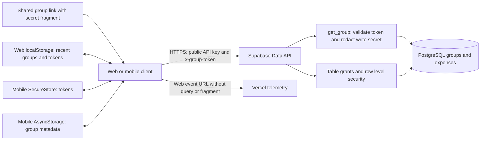

# TeilFair security review

Reviewed on 4 November 2026 against commit `eb56a9016aedca90bdd208cc7c1e91e71e3b476f`. Scope: the web application, native mobile application source, shared library, Supabase migrations and declarations, deployment configuration, CI, and root workspace dependency graph.

**Overall rating: AMBER — moderate risk; improvements required.** The tested database authorization is a sound foundation for the intended account-free, secret-link sharing model. Registration-free use and persistent browser tokens are explicit product requirements: users should be able to return without separately saving their links. F1 and F7 are therefore classified as accepted design tradeoffs, with optional hardening, rather than vulnerabilities in those choices. The overall rating reflects the remaining implementation findings, especially F2–F5, and the unverified production configuration.

The access boundary is possession of a valid secret link. Sharing that link grants its permissions, and a recipient can forward it. Protection against someone who has no token is the security requirement; proving the identity of each link holder is outside the intended model.

No arbitrary-group read bypass was found for an outsider without a valid capability in the reviewed paths. This conclusion is supported by isolated database tests, not verification of the deployed Supabase project. Production safety still depends on applying the reviewed migrations and retaining the same grants, policies, exposed schemas, and client configuration.

| Area | Rating | Assessment |
| --- | --- | --- |
| Outsider without a group token | Good in tested database | Missing/wrong tokens cannot read protected rows; knowing a group UUID is insufficient. |
| Read-only versus edit access | Good in tested database | Readers cannot perform tested writes or obtain the write token through `get_group` or direct column reads. |
| Account-free sharing | Accepted design | Possession of the shared token grants access; recipients can forward it. No identity-bound invitation requirement. |
| Cross-group relationships and data integrity | Needs improvement | Foreign-group member references, invalid totals, and stale client state were reproduced. |
| Persistent device access | Accepted design | Browser tokens persist to preserve access across visits. Mobile uses SecureStore. Protect tokens from script execution and diagnostic leakage. |
| Hosted deployment | Unverified | Local source/configuration does not prove the live deployment matches. |

These are qualitative engineering ratings, not a certification or a claim that every possible attack was tested. No application behavior or production settings were changed during this review.

## Data flow and trust boundaries

The clients generate two independent 32-character tokens using `crypto.getRandomValues` and rejection sampling. The 62-character alphabet yields approximately 190 bits of entropy per default token. Guessing a normally generated token is therefore not a realistic attack path. The server checks token length and difference, but accepts client-chosen tokens; it does not prove their entropy. See `packages/shared/src/crypto.ts:6` and `supabase/schemas/public/tables/groups.sql:21`.

The public Supabase key is expected to be visible in the clients. Authorization comes from `x-group-token`, database grants, and RLS, not secrecy of that API key. Both clients create a separate client with the requested group header. The source uses public/anon environment variables; it does not intentionally embed a service-role credential in these client constructors.

New links use `#t=...`, which is not part of the HTTP request to the website host. Legacy `?t=...` links still reach the host with the secret on the first request; `bootstrap.js` only cleans the URL afterward. The deployment sets `no-referrer`, and telemetry hooks remove query strings and fragments. The browser tests verified fragment behavior and the configured CSP locally. Actual hosted telemetry payloads and log retention were not inspected.

This is not end-to-end encryption. The Supabase database stores readable expense data and raw capabilities. Database administrators and sufficiently privileged infrastructure credentials remain trusted. A browser script executing in the app origin can also read its local storage and URL fragment. Mobile token storage uses the OS-backed SecureStore adapter; names and recent expense summaries remain ordinary local metadata.

## Findings and accepted design tradeoffs

### F1 Accepted design tradeoff — account-free access through transferable secret links

**Where:** `supabase/schemas/public/tables/groups.sql:1`, `supabase/schemas/private/functions/check_group_access.sql:1`, `supabase/schemas/public/functions/get_group.sql:1`, and sharing in both clients.

**Design requirement:** Anyone should be able to use and share expenses without registering. Authorization therefore compares the supplied token with the group's two stored tokens. No user accounts or identity-bound invitations are recommended for this product. The `members` table contains names used in calculations; adding/removing such a member does not grant/revoke that person's access. Everyone with the write link can edit and delete group data, including by direct API requests. This is expected behavior.

A forwarded, copied, or stolen link works for a third person exactly as it does for the intended recipient. Removing a group from recent groups only forgets it locally. A direct attempt to rotate `write_token` with the old write token was rejected in the isolated reproduction: the update policy also checks the resulting row. There is no dedicated rotation RPC or UI. An administrator can repair/rotate credentials manually, but that is not a user-access lifecycle.

**Compatible hardening:** Explain that anyone with the link has its permissions. Consider an explicitly requested “replace compromised links” operation, without requiring accounts or expiring access automatically. Such an operation must define who can invoke it, persist replacement credentials before discarding the old ones, and explain that everyone using the replaced link will need a new one. With the current shared write token, there is no way to distinguish a creator from another writer or a thief who holds that token; a separately held management/recovery capability would be an optional design extension. This is a recovery feature proposal, not a prerequisite for accepting the account-free model.

The recent-groups share shortcuts currently copy the saved capability directly (`packages/web/src/components/HomeRecentGroups.tsx:47`, `packages/mobile/src/screens/HomeScreen.tsx:108`). For a creator this normally shares full edit access without the permission choice offered by the main share dialog. Default sharing to read-only and clearly label any edit-link action.

**Acceptance:** A fresh client without a valid group token cannot read or modify the group. A shared reader token cannot obtain edit authority. A valid link works without registration, including after being forwarded. If voluntary rotation is implemented, old links fail across every endpoint and the initiating device retains the replacement. Previously downloaded data cannot be recalled.

### F2 Medium — payer and split rows can reference a member in another group

**Where:** `supabase/schemas/public/tables/expense_payers.sql:10` and `:27`; `supabase/schemas/public/tables/expense_splits.sql:12` and `:29`; related member/expense update policies.

**Reproduced:** With only group A's write token, inserting a payer and split for A's expense using a known group B member UUID succeeded. Direct reads of B and B's members still returned no rows. The child-row policies check the expense's group but never require the member to belong to that same group. A foreign key to `members(id)` establishes existence, not group equality. A nonexistent UUID produced a foreign-key error, providing a limited existence oracle for already-known candidate UUIDs.

Deleting that member as B's writer then cascaded into A's payer/split rows. This is a real isolation/integrity flaw, but does not by itself disclose B's names, expenses, or tokens. Exploitation requires knowing a foreign member UUID and having write access to an expense in some group.

**Improve:** Enforce that expense and member belong to the same group for both insert and update, preferably with a shared `group_id` and composite foreign keys to `(group_id, id)` on each parent. Restrict parent group reassignment or ensure those constraints also cover it. RLS checks alone on child insertion do not protect against later parent movement. Detect and repair existing inconsistent rows before applying constraints.

**Acceptance:** Cross-group payer/split inserts and updates fail, as do parent moves that would create an inconsistent relationship. Same-group operations still work. Cover `anon` and `authenticated` through real REST tests as well as SQL tests.

### F3 Medium — failed navigation retains the previous group's data and write authority

**Where:** `packages/shared/src/store/groupStore.ts:132`; `packages/web/src/pages/GroupPage.tsx:157`; `packages/mobile/src/screens/GroupScreen.tsx:243`.

**Reproduced against the actual store source:** Load A successfully with write access, then load B with an invalid token. The B load returns false, but A's `group`, `members`, `expenses`, `permission`, and `token` remain in the store. Calling `addMember` still targets A with A's token. Both screens display the existing group when loading/errors occur because their status checks require `!group`. Neither verifies that the displayed group's ID and authorization correspond to the current route.

This can expose previously loaded data on a shared session and cause edits to the wrong group. It is not a remote bypass in a fresh browser without A's token. Overlapping loads also lack a request-generation guard, so an older response may replace newer navigation state.

**Improve:** Clear the active group and capability on a group/token change or authorization failure, suppress all mutations until the current route is authorized, and discard superseded responses. Render data only when the authorized group/token matches the requested route. Clear active state when forgetting the active group.

**Acceptance:** Cover valid A → invalid B, valid A → invalid token for A, writer → reader, late A response after B, and forgetting the active group. No stale content or edit buttons should remain, and no action should use the previous token.

### F4 Medium — expense changes are not atomic and accounting validation is client-side

**Where:** `packages/web/src/lib/api.ts:223` and `:299`; `packages/mobile/src/lib/api.ts:221` and `:294`; `supabase/schemas/public/tables/expenses.sql` and child tables.

**Evidence:** Creating an expense sends separate expense, payer, and split requests. Updating first changes the expense, deletes children, and reinserts replacements. A later failure leaves earlier successful requests committed. The results of the two delete requests are not checked for Supabase `error` values. The database enforces positive individual numbers but not payer totals, complete allocations, or percentage totals. The SQL reproduction accepted a payer amount of 999 and a 200% split against an expense total of 10.

An authorized writer can already edit expenses by design, so this is not unauthorized group access. It permits invalid balances through direct API calls and accidental partial updates through network failures or concurrent edits.

**Improve:** Move expense creation/replacement to transaction-backed database functions that explicitly enforce the caller's write capability and validate the complete payload. Preserve all authorization checks if a privileged function is required. Close direct mutation paths that could bypass the new invariants, or enforce equivalent database constraints. Add revision checks to prevent silent concurrent overwrites. Decide whether deleting a referenced member should be rejected rather than silently deleting their accounting rows.

**Acceptance:** Invalid totals/allocations fail through every exposed write path. Any failed replacement leaves the original expense, payers, and splits intact. Concurrent edits either serialize safely or return a conflict.

### F5 Medium hardening gap — application roles have unnecessary whole-table privileges

**Where:** `supabase/schemas/public/tables/groups.sql:66` and `:84`, corresponding grants in all other table files, and `supabase/schemas/public/default_privileges.sql:9` through `:17`.

**Reproduced:** With the starting grants used by the repository's existing security harness and migrations 001–006, the `anon` SQL role executed `TRUNCATE public.groups CASCADE` without a token. All test rows disappeared inside the rolled-back transaction. The declarative schema explicitly contains those grants too.

**Reachability matters:** No generic SQL execution or truncate RPC was found in this application. This does **not** demonstrate that an anonymous HTTP caller can truncate production. It demonstrates excessive privilege that becomes dangerous if a SQL execution path is introduced or exposed. RLS does not protect `TRUNCATE` or `REFERENCES`; PostgreSQL documents this explicitly in its [row security reference](https://www.postgresql.org/docs/17/ddl-rowsecurity.html).

**Improve:** Revoke unnecessary `TRUNCATE`, `REFERENCES`, `TRIGGER`, and `MAINTAIN` permissions from `anon`/`authenticated`; retain only the operations and columns the app needs. Remove broad automatic future table/function exposure and explicitly grant new endpoints. Preserve the intentional token checks and restricted token-column grants. Review function default privileges at both global and schema levels, following [Supabase's API security guidance](https://supabase.com/docs/guides/api/securing-your-api).

**Acceptance:** Assert forbidden table privileges are absent and a newly created table/function receives no unintended public access. Repeat existing CRUD and token-redaction tests to prevent a functional regression.

### F6 Medium availability risk — anonymous creation lacks application-level abuse controls

**Where:** `supabase/schemas/public/tables/groups.sql:21`, unrestricted text/token column sizes, direct Supabase clients, and `supabase/config.toml`.

**Evidence:** Any caller can create groups with arbitrary sufficiently long distinct tokens. No application quota, creation throttle, server-verified challenge, or upper string-length constraint was found. API response `max_rows` is not a write/storage quota. Hosted gateway protections were not inspected, and no flooding or resource-exhaustion test was performed.

**Improve:** Bound names, descriptions, token sizes, and batch sizes in the database/API. Enforce creation and mutation quotas at the actual Supabase entry point or a trusted API with direct bypass paths closed. A Vercel-only limiter or browser-only CAPTCHA would leave direct database requests available. Add monitoring and an abuse-response policy; avoid logging raw capabilities.

**Acceptance:** Excess creation receives a controlled rejection, oversized payloads fail server-side, and the same restrictions apply when requests bypass the website UI.

### F7 Accepted design tradeoff — persistent browser tokens preserve access across visits

**Where:** `packages/web/src/store/groupStore.ts:26`, `packages/shared/src/store/groupStore.ts:368`, `packages/mobile/src/lib/groupStorage.ts`, and the raw token columns in `groups`.

**Design requirement:** Web recent groups must persist capabilities by default so users do not lose access when they close the browser or forget to save a link. Keep this behavior; session-only storage, mandatory opt-in remembering, and automatic token expiry are not recommended for the stated requirements. Persistence itself is not a vulnerability.

**Residual exposure:** URL fragments and localStorage are accessible to scripts executing in the app origin; browser history, copied links, and extensions with relevant permissions can also expose capabilities. The mobile adapter correctly separates tokens into SecureStore and passed its migration/storage tests. Stored group names and summaries are still visible to someone with access to that app/device storage. Persistent browser access assumes the browser profile is trusted; someone using that same profile can reopen its saved groups.

No exploitable XSS sink was found in the reviewed application source. The configured CSP blocks inline JavaScript, which the smoke tests verified. These are useful protections, but authorized same-origin scripts still have access to browser secrets. The CSP also permits connections to any `*.supabase.co` project, widening exfiltration destinations if script execution is compromised.

**Compatible hardening:** Preserve default persistence while preventing XSS and minimizing third-party script access. Restrict connections to the deployed Supabase project and remove unused protocols. Consider disabling telemetry on sensitive routes and replacing group UUIDs in telemetry paths with a route template. Scrub `x-group-token`, legacy query tokens, and token-bearing request/response bodies from diagnostic pipelines. An explicit “forget all groups on this device” action can help shared-device users, but must explain the loss of local access and offer a chance to save links first; do not clear capabilities automatically. Browser data deletion can still remove local access, so optional link backup remains useful.

For database compromise resistance, capability digests are a separate optional hardening measure that does not require removing browser persistence; they would require redesigning server-side link retrieval/sharing. Client-side encryption with a key stored alongside the ciphertext would not solve same-origin script theft.

**Acceptance:** Returning after a browser restart restores saved group access without registration or manual token entry. Navigation errors do not delete saved capabilities for other groups. Deliberate forgetting removes the chosen local credentials, while logs and telemetry never include them. The F3 fix must clear stale active state without indiscriminately clearing the persistent recent-groups store.

### F8 Medium maintenance priority — four dependency advisories require triage

Both `pnpm audit --prod --json` and the full root workspace audit reported the same four advisories. The reported paths run through Expo CLI/configuration/build packages. Their presence in the production dependency graph does not establish that the vulnerable code is shipped in native bundles or reachable from a group request. No exploit against TeilFair was demonstrated.

| Installed dependency | Advisory severity | Reported fix | Observed path and concern |
| --- | --- | --- | --- |
| `zod@3.25.76` | High | `>=4.6.6` | `expo → @expo/cli → zod`; excessive memory use during validation. [Advisory](https://github.com/advisories/GHSA-mrhx-c7xc-m3w5). |
| `minimatch@10.2.6` | Moderate | `>=11.0.1` | Expo build/config tooling; pattern amplification. [Advisory](https://github.com/advisories/GHSA-g3hv-75wg-m249). |
| `glob@13.0.6` | Moderate | `>=14.0.2` | Expo build/config tooling; traversal continues after cancellation. [Advisory](https://github.com/advisories/GHSA-3g3m-2fjr-6pw4). |
| `deepmerge@4.3.1` | Low | None listed | `expo → @expo/config → deepmerge`; returned-object prototype poisoning. [Advisory](https://github.com/advisories/GHSA-gcqx-w48m-w2h4). |

**Improve:** Upgrade through compatible Expo/tooling releases, or apply a reviewed upstream fix. Do not blindly override incompatible major versions to silence the audit. Establish whether untrusted inputs reach the affected functions; document temporary exceptions with owners and review dates. Add an advisory check to CI alongside existing weekly Dependabot updates. The separate AppHost lockfile was not independently audited.

## Protections worth preserving

- RLS is enabled on all five application tables; group-scoped authorization is enforced in the database rather than solely by UI visibility.
- Direct reads of secret columns are denied to `anon` and `authenticated`. `get_group` validates access and redacts the write capability for readers.
- Privileged access functions have an empty search path and schema-qualified object references. The internal helper is in `private`, which local API configuration does not expose.
- Default client token generation uses a cryptographic source and fails when it is unavailable; it does not fall back to `Math.random`.
- Fragment links, `no-referrer`, telemetry URL scrubbing, and a script CSP reduce accidental capability disclosure.
- Mobile capabilities are stored separately in SecureStore with tested migration and serialized persistence.
- CI already runs database authorization, storage, report-redaction, and browser tests. System-test reports intentionally avoid uploading live capabilities.

Do not mistake an omitted explicit update `WITH CHECK` for an automatic authorization bypass: PostgreSQL reuses `USING` when the check is omitted. An explicit check can improve readability, but the missing cross-group relationship check in F2 is a separate issue. See [PostgreSQL CREATE POLICY](https://www.postgresql.org/docs/current/sql-createpolicy.html).

## Verification performed

| Check | Result and scope |
| --- | --- |
| `node scripts/test-database-security.mjs` | Passed in disposable PostgreSQL 17: missing/invalid tokens, reader/writer behavior, token-column protection, both API roles, physical cascades, migration reapplication, and recovery from disabled RLS. |
| `node --test --test-isolation=none scripts/test-mobile-storage.mjs scripts/test-system-reporter.mjs` | 8 passed. Native storage APIs are mocked; real adapter/reporter code executes. |
| `pnpm --filter @teilfair/shared test` | 120 tests passed across 5 files. |
| `pnpm --filter @teilfair/web exec playwright test --config playwright.smoke.config.ts security.spec.ts` | 10 passed across desktop and mobile-emulated Chromium. Production web build and configured headers; backend responses are mocked. This does not prove hosted API enforcement or native-device behavior. |
| `node docs/security-review-2026-11-04.probe.mjs` | Reproduced foreign-group child references, inconsistent totals, cross-group cascade effects, blocked direct token rotation, excessive SQL-role truncate privilege, and stale store authority. |
| Root workspace production/full dependency audits | Both reported 1 high, 2 moderate, 1 low, 0 critical advisories. |

The accompanying probe is **evidence of current behavior, including implementation flaws, not a passing security gate**. Its successful exit means it reproduced the documented behavior; blocked direct token rotation records a lifecycle limitation, not a failure of the accepted account-free design. It uses synthetic data in a new disposable container with no published ports, host mounts, or hosted credentials, rolls back the SQL probes, and removes the container. After fixes, replace the implementation-flaw assertions with regression tests that require rejection or safe state transitions.

Not verified: live deployment/migration drift, hosted exposed schemas and extra database objects, storage/realtime permissions if enabled remotely, real PostgREST/GraphQL adversarial requests, native iOS/Android binary behavior and link association, production telemetry/log payloads, backup restoration, organization access/MFA, secret exposure in Git history, and exhaustive XSS/supply-chain testing. Production data was neither accessed nor modified.

## Improvement order and release evidence

1. **Preserve the agreed product model and verify deployment.** Keep registration-free sharing and default browser persistence. Describe links as transferable access credentials. Confirm hosted migrations 004 and 006 and actual grants/policies match this review before claiming production isolation.
2. **Fix F2 and F3.** Enforce same-group relationships and clear/synchronize client authorization state. These are concrete reproduced defects.
3. **Fix F4 and F5.** Make accounting writes atomic and validated, and remove unnecessary privileges/default exposure. Follow the existing schema-first workflow in `docs/database-workflow.md`; preserve applied migrations and generate reviewed incremental migrations.
4. **Address F6 and F8 and consider compatible hardening.** Apply API abuse limits and compatible dependency remediation. F1/F7 hardening can reduce accidental sharing, token leakage, and recovery difficulty while retaining accounts-free access and durable browser storage.
5. **Require a release access matrix against a disposable deployed-equivalent backend.** Test no token, malformed token, other-group token, reader, and writer using both database API roles across every table, RPC, insert/update/upsert/delete, embedded relation, and enabled GraphQL path. Test old tokens if voluntary rotation is added. Include browser-restart persistence, attempts to read/filter secret columns, and moves of parent/child rows between groups. Check final row contents, not just HTTP status codes: an RLS-filtered mutation can succeed with zero affected rows.

For production approval, capture read-only evidence of enabled RLS, all policies/grants/functions, applied migrations, exposed API schemas, absence of frontend service-role credentials, HTTPS/security headers, and redacted diagnostics. Check for extra permissive policies or functions introduced outside the repository. A source review and green local tests cannot establish these deployment facts.
